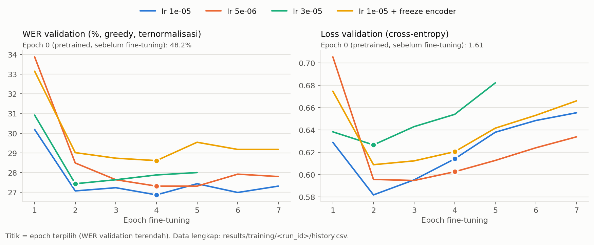

# Training dan eksperimen — bahan laporan Orang 4

Bagian ini menjelaskan fine-tuning Whisper small pada data latih Bahasa Palembang,
eksperimen yang dijalankan, dan alasan pemilihan model final. Semua angka adalah
**validation** (235 ujaran, speaker S03 dan S06) dengan aturan metrik seleksi
Orang 4. Data test tidak dipakai untuk training maupun pemilihan; evaluasi test
dan angka resmi dilakukan Orang 5.

## Protokol training

**Data.** Training memakai split `palembang_internal_v1` dari Orang 1. Split ini
speaker-independent: tidak ada speaker yang muncul di dua split.

| Split | Speaker | Ujaran dipakai |
|---|---|---|
| Train | S01, S02, S04, S07, S08, S09, S11 | 755 (58 menit audio) |
| Validation | S03, S06 | 235 |
| Test | S05, S10 | tidak dibaca |

Dari 762 ujaran train, 755 ditandai `train_eligible` oleh Orang 2. Tujuh ujaran
tidak dipakai: enam karena referensinya memuat masking `[nama]` (model tidak boleh
belajar menghilangkan nama yang diucapkan), dan satu karena tidak ada audio aktif. Audio dibaca per rentang anotasi dengan
preprocessing `preprocess_v1` Orang 2 (mono, 16 kHz, tanpa transformasi
tambahan). Target training adalah teks ternormalisasi Orang 2: huruf kecil, tanpa
tanda baca dan tag seperti `[unclear]`, tanda hubung di dalam kata dipertahankan,
dan ejaan Palembang tidak diubah.

**Model.** Titik awal adalah `openai/whisper-small` (242 juta parameter),
revision `973afd24965f72e36ca33b3055d56a652f456b4d`. Ini bobot yang sama
dengan baseline Orang 3, dalam format PyTorch. Prosesor log-Mel dan tokenizer
tidak diubah, dan tidak ada token baru. Decoder diberi prefix tetap
`<|id|> <|transcribe|> <|notimestamps|>`, sama dengan hint bahasa saat inference.

**Optimasi.** Training memakai loop PyTorch sendiri (`phase2/src/train.py`):

| Hiperparameter | Nilai acuan |
|---|---|
| Optimizer | AdamW, weight decay 0,01 |
| Learning rate | 1e-5, warmup linear 10% lalu turun linear ke 0 |
| Batch efektif | 16 (8 per langkah × akumulasi gradien 2), 48 langkah per epoch |
| Epoch maksimum | 8, early stopping patience 3 |
| Lain-lain | gradient clipping 1,0; mixed precision fp16; seed 42 |

**Seleksi checkpoint.** Validation dievaluasi sebelum training (epoch 0) dan di
akhir setiap epoch. Setiap evaluasi menghitung loss validation (231 ujaran tanpa
`[nama]`) dan WER/CER dari decoding greedy (seluruh 235 ujaran). Checkpoint terbaik adalah epoch dengan **WER validation
terendah**; jika seri, loss validation yang lebih rendah menang. Prediksi setiap
epoch disimpan agar seleksi bisa diperiksa ulang.

**Metrik seleksi.** WER/CER level korpus dihitung dengan jiwer 4 setelah teks
referensi dan prediksi dinormalisasi dengan fungsi Orang 2. CER menghitung spasi.
Token `[nama]` di referensi hilang saat normalisasi, sehingga nama yang
diucapkan dan ditranskripsi model dihitung sebagai insertion. Aturan ini hanya
untuk seleksi; kebijakan scoring resmi milik Orang 5.

**Inference setelah training.** Checkpoint terpilih dikonversi ke CTranslate2
float16, lalu didecode lewat adapter `WhisperASR` Orang 3 dengan pengaturan yang
sama seperti baseline (CPU, INT8, beam 1). Dengan begitu, perbandingan
pretrained dan fine-tuned hanya berbeda pada bobot model.

## Desain eksperimen

Setiap eksperimen mengubah **satu faktor** dari konfigurasi acuan. Test otomatis
memeriksa bahwa config eksperimen hanya berbeda satu kunci dari acuan.

| Eksperimen | Faktor | Pertanyaan |
|---|---|---|
| Pretrained beam 1 | — | Baseline tanpa fine-tuning |
| Pretrained beam 5 | decoding | Apakah pencarian lebih luas membantu? |
| Pretrained RMS + trim | preprocessing | Apakah normalisasi RMS dan trimming membantu? |
| Fine-tune lr 1e-5 | — | Konfigurasi acuan fine-tuning |
| Fine-tune lr 5e-6 / 3e-5 | learning rate | Seberapa sensitif hasil terhadap learning rate? |
| Fine-tune lr 1e-5, encoder beku | parameter dilatih | Cukupkah hanya melatih decoder (153 juta dari 242 juta parameter)? |
| Fine-tuned terbaik, beam 5 | decoding | Apakah beam 5 masih membantu setelah fine-tuning? |

Variasi batch size dan jumlah epoch tidak dijadikan eksperimen terpisah. Batch
efektif 16 sudah sebanding dengan resep fine-tuning Whisper umum. Jumlah epoch
ditentukan early stopping: semua run berhenti sebelum batas 8 epoch, jadi batas
itu tidak membatasi hasil. Varian preprocessing tidak diulang untuk fine-tuning,
karena pada model pretrained efeknya kecil (bagian hasil) dan Orang 2 baru
menyediakan manifest terproses untuk `preprocess_v1`.

## Komputasi

Fine-tuning dijalankan di Kaggle (1× Tesla T4) sebagai satu job berisi empat run
berurutan, sekitar 50 menit total. Satu epoch full fine-tuning memakan ±90 detik;
dengan encoder beku ±39 detik. Evaluasi validation per epoch ±28 detik. Kernel
mengambil kode dari commit Git yang tercatat (`9178323`), sehingga hasil Kaggle
dapat ditelusuri ke kode yang sama dengan repo. Decoding dijalankan di laptop CPU
(4 thread). Waktunya tercatat, tetapi bukan benchmark karena laptop juga dipakai
untuk pekerjaan lain.

## Hasil

*Gambar 1. WER dan loss validation per epoch fine-tuning (pipeline HF, greedy).
Titik menandai epoch terpilih. Epoch 0 (pretrained) tidak diplot agar skala tidak
tertekan; nilainya WER 48,2% dan loss 1,61.*

| Model | Decoding | WER | CER | Sub | Del | Ins |
|---|---|---|---|---|---|---|
| Pretrained | beam 1 | 47,35% | 17,49% | 919 | 182 | 69 |
| Pretrained, RMS + trim | beam 1 | 46,50% | 16,90% | 911 | 166 | 72 |
| Pretrained | beam 5 | 44,15% | 15,42% | 848 | 172 | 71 |
| Fine-tune lr 1e-5, encoder beku | beam 1 | 28,53% | 10,23% | 523 | 70 | 112 |
| Fine-tune lr 3e-5 | beam 1 | 28,13% | 10,09% | 530 | 66 | 99 |
| Fine-tune lr 5e-6 | beam 1 | 27,52% | 9,76% | 508 | 73 | 99 |
| Fine-tune lr 1e-5 | beam 1 | 26,99% | 9,44% | 495 | 64 | 108 |
| **Fine-tune lr 1e-5 (final)** | beam 5 | **26,18%** | **9,22%** | 471 | 63 | 113 |

*Tabel 1. Hasil validation (235 ujaran; 2.471 kata dan 14.276 karakter referensi)
lewat adapter inference Orang 3, CPU INT8.*

**Fine-tuning menurunkan WER sekitar 43% relatif** (47,35% → 26,99%) dan CER
sekitar 46% relatif (17,49% → 9,44%). Penurunan terjadi pada kedua speaker
validation: S03 dari 52,8% ke 31,4% dan S06 dari 41,7% ke 22,4%. Substitusi
hampir terpangkas separuh (919 → 495), dan deletion turun dari 182 ke 64. Model
pretrained menghasilkan keluaran kosong pada 7 ujaran; model fine-tuned tidak
pernah. Insertion justru naik (69 → 108). Insertion ini tersebar, umumnya 1–4 kata
per ujaran; tidak ada pengulangan tak berujung. Sebagian kecil berasal dari ujaran
`[nama]` (11 insertion pada 4 ujaran), yaitu nama yang diucapkan pembicara.

**Learning rate.** Ketiga learning rate menghasilkan WER dalam rentang 1,1 poin
(26,99–28,13%). Paired bootstrap per ujaran (10.000 sampel ulang) memberi
interval 95% selisih terhadap lr 1e-5 sebesar [−0,6; +1,7] poin untuk lr 5e-6
dan [−0,3; +2,5] poin untuk lr 3e-5. Keduanya melewati nol, jadi **perbedaan ini
belum dapat dibedakan dari variasi sampel**. Polanya tetap konsisten dengan
Gambar 1: lr 3e-5 mencapai minimum lebih cepat (epoch 2) lalu memburuk, sedangkan
lr 5e-6 belajar lebih lambat.

**Encoder beku.** Melatih decoder saja memberi WER 1,5 poin lebih buruk, dengan
interval [+0,1; +2,9]. Artinya encoder juga perlu beradaptasi dengan akustik
penutur Palembang, walaupun keuntungannya kecil dibanding efek fine-tuning itu
sendiri. Keunggulan varian ini adalah waktu: satu epoch ±2,3× lebih cepat.

**Decoding dan preprocessing.** Pada model pretrained, beam 5 menurunkan WER 3,2
poin, sedangkan RMS + trim hanya 0,9 poin. Pada model fine-tuned, beam 5
masih menurunkan WER 0,8 poin (26,99% → 26,18%), dengan interval [−1,6; −0,04] dan
perbaikan pada kedua speaker (S03 31,4% → 30,7%; S06 22,4% → 21,5%). Efek ini jauh lebih
kecil daripada pada model pretrained. Kemungkinan penyebabnya, hipotesis greedy model
fine-tuned sudah jarang dikalahkan hipotesis lain, tetapi hal ini belum diperiksa.

**Overfitting dan pilihan metrik seleksi.** Loss validation mencapai minimum di
epoch 2 (epoch 3 untuk lr 5e-6), lalu naik, sementara loss training terus turun mendekati
nol (0,006 di epoch 7 untuk lr 1e-5). WER validation tetap datar atau sedikit
membaik hingga epoch 4. Naiknya loss mencerminkan model yang terlalu yakin pada
token yang salah, bukan memburuknya transkripsi greedy. Karena itu seleksi
berdasarkan WER memilih epoch 4, bukan epoch 2.

## Pemilihan model final

Model final adalah **checkpoint `ft_lr1e-5_001` epoch 4 dengan decoding
beam 5**. Config inference:
`phase2/configs/experiments/finetuned_ft_lr1e-5_001_beam5.json`.

Alasan:

1. WER dan CER validation terendah di antara semua checkpoint, baik di pipeline
   training (HF greedy, 26,87%) maupun lewat adapter inference Orang 3 (26,99%).
   Kedua pipeline memberi peringkat yang sama.
2. Learning rate 1e-5 adalah titik tengah. Learning rate tetangganya tidak
   berbeda nyata, sehingga pilihan ini tidak bergantung pada nilai ekstrem.
3. Beam 5 menurunkan WER 0,8 poin dan CER 0,2 poin dibanding beam 1 dengan bobot
   yang sama, dan membaik di kedua speaker. Batas atas intervalnya dekat nol (−0,04
   poin), tetapi arahnya sama dengan pada model pretrained (−3,2 poin). Biayanya,
   decoding beam 5 lebih lambat. Untuk demo yang membutuhkan respons cepat, config
   beam 1 (`finetuned_ft_lr1e-5_001.json`) memakai bobot yang sama dan hanya 0,8
   poin WER lebih buruk.

Model dipilih berdasarkan validation, yang juga dipakai untuk memilih epoch.
Karena itu WER validation 26,18% cenderung sedikit optimistis. Angka yang
mewakili kemampuan generalisasi adalah hasil test dari Orang 5.

## Keterbatasan

- **Satu seed per konfigurasi.** Variasi akibat inisialisasi urutan data belum
  diukur. Perbedaan antar-learning rate yang lebih kecil dari ±1,5 poin perlu
  dianggap setara.
- **Validation kecil dan hanya dua speaker.** Bootstrap mengambil sampel ulang
  ujaran, bukan speaker. Interval di atas tidak mencakup variasi antar-speaker,
  sehingga ketidakpastian sebenarnya lebih besar.
- **Data training sedikit** (58 menit, tujuh speaker). Loss training hampir nol
  menunjukkan model menghafal data latih. Augmentasi (SpecAugment, speed
  perturbation) atau data tambahan belum dicoba.
- **Referensi Fase 1 didraf dengan Whisper large-v3 lalu direview.** Hal ini
  dapat membuat referensi condong ke gaya keluaran Whisper (lihat laporan Orang 3).
- **Metrik seleksi bukan metrik resmi.** Penanganan `[nama]`, angka, dan ejaan
  varian mengikuti normalisasi Orang 2. Scorer Orang 5 dapat memberi angka
  sedikit berbeda.
- Bobot model fine-tuned (±466 MB per run) tidak ada di Git. Bobot didistribusikan
  lewat Google Drive dan diverifikasi dengan hash SHA-256 di config.

## Reproduksi

Perintah lengkap ada di [README Fase 2](../README.md#training-dan-eksperimen--orang-4).
Log kronologis seluruh run, termasuk run yang dibatalkan, ada di
[experiment log](../docs/experiment_log.md).
